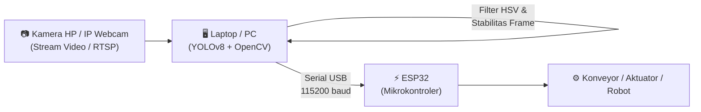

# 🤖 YOLOv8 & ESP32 Vision-Based Object Sorting System

Sistem computer vision real-time berbasis **YOLOv8** dan **OpenCV** yang terhubung langsung ke **ESP32** melalui komunikasi Serial USB. Sistem ini dirancang untuk mendeteksi, mengklasifikasi, dan mengirimkan koordinat objek (**tutup botol** dan **koin**) pada konveyor/meja kerja otomatis untuk keperluan otomasi industri atau pemilahan robotik (*pick and place*).

---

## 📌 Fitur Utama

- **Deteksi Objek Real-Time**: Menggunakan model kustom Ultralytics YOLOv8 yang dioptimasi untuk mendeteksi tutup botol (`bottle-cap`) dan koin (`coin`).
- **Koreksi Pintar HSV (Anti False-Positive)**: Menggunakan analisis saturasi warna (HSV) untuk membedakan material koin logam (saturasi rendah) dan tutup botol plastik (saturasi tinggi) secara akurat.
- **Filter Stabilitas Frame**: Objek wajib terdeteksi secara konsisten selama beberapa frame berturut-turut sebelum perintah dikirim untuk mencegah trigger palsu akibat noise kamera.
- **Cooldown Throttling**: Mekanisme jeda waktu pengiriman agar mikrokontroler ESP32 tidak mengalami kebanjiran data (*buffer overflow*).
- **Komunikasi Serial USB**: Mengirimkan data koordinat piksel dan jenis objek secara terstruktur langsung ke ESP32.
- **Mode Testing Otomatis**: Jika ESP32 belum terhubung, program tetap berjalan normal dalam mode visualisasi testing tanpa menimbulkan crash.

---

## 🏗️ Arsitektur Sistem



---

## 📁 Struktur Direktori

```text
Deteksi_Object/
│
├── models/
│   ├── best_update.pt       # Model bobot YOLOv8 kustom aktif
│   └── best.onnx            # Ekspor model format ONNX (opsional)
│
├── deteksi.py               # Script utama deteksi objek & pengiriman Serial
├── tes_kamera.py            # Utility untuk menguji koneksi webcam lokal
├── capture_dataset.py       # Script pembantu pengambilan frame dataset baru
├── requirements.txt         # Daftar pustaka / dependensi Python
├── .gitignore               # Daftar file/folder yang diabaikan Git
└── README.md                # Dokumentasi proyek
```

---

## 🔌 Format Protokol Serial ke ESP32

Data dikirimkan melalui kabel USB ke port COM ESP32 dengan format string berakhiran newline (`\n`):

```text
STOP,<nama_objek>,<cx>,<cy>\n
```

### Contoh Pesan:
- Deteksi Koin: `STOP,coin,320,240\n`
- Deteksi Tutup Botol: `STOP,bottle-cap,410,185\n`

### Contoh Kode Penerima di ESP32 (Arduino C++):
```cpp
void setup() {
  Serial.begin(115200);
}

void loop() {
  if (Serial.available()) {
    String data = Serial.readStringUntil('\n');
    data.trim();

    if (data.startsWith("STOP")) {
      int idx1 = data.indexOf(',');
      int idx2 = data.indexOf(',', idx1 + 1);
      int idx3 = data.indexOf(',', idx2 + 1);

      String label = data.substring(idx1 + 1, idx2);
      int cx = data.substring(idx2 + 1, idx3).toInt();
      int cy = data.substring(idx3 + 1).toInt();

      // Eksekusi aksi robot berdasarkan label dan posisi (cx, cy)
      if (label == "coin") {
        // Logika sortir koin
      } else if (label == "bottle-cap") {
        // Logika sortir tutup botol
      }
      
      // Kirim feedback ke PC
      Serial.println("PROCESSED_OK");
    }
  }
}
```

---

## 🚀 Panduan Instalasi & Menjalankan

### 1. Kloning Repository
```bash
git clone https://github.com/username-anda/yolov8-esp32-object-sorting.git
cd yolov8-esp32-object-sorting
```

### 2. Buat & Aktifkan Virtual Environment (Disarankan)
```bash
# Windows
python -m venv env
.\env\Scripts\activate
```

### 3. Install Dependensi
```bash
pip install -r requirements.txt
```
*(Atau install manual: `pip install ultralytics opencv-python pyserial numpy`)*

### 4. Konfigurasi `deteksi.py`
Buka file `deteksi.py` dan sesuaikan parameter berikut:
```python
stream_url = "http://192.168.1.XX:8080/video"  # URL stream kamera IP Anda
SERIAL_PORT = "COM3"                          # Port COM ESP32
SERIAL_BAUD = 115200                          # Baud rate
```

### 5. Jalankan Program
```bash
python deteksi.py
```
- Tekan **`q`** pada jendela preview kamera untuk keluar.

---

## 🛠️ Tech Stack

- **Deep Learning**: [Ultralytics YOLOv8](https://github.com/ultralytics/ultralytics) (PyTorch)
- **Computer Vision**: OpenCV (Python)
- **Hardware Interface**: PySerial
- **Mikrokontroler**: ESP32 (WROOM / NodeMCU-32S)
- **Dataset Annotation**: Roboflow

---

## 📄 Lisensi
Proyek ini dibuat untuk keperluan edukasi, riset otomasi industri, dan open-source di bawah lisensi [MIT License](LICENSE).
